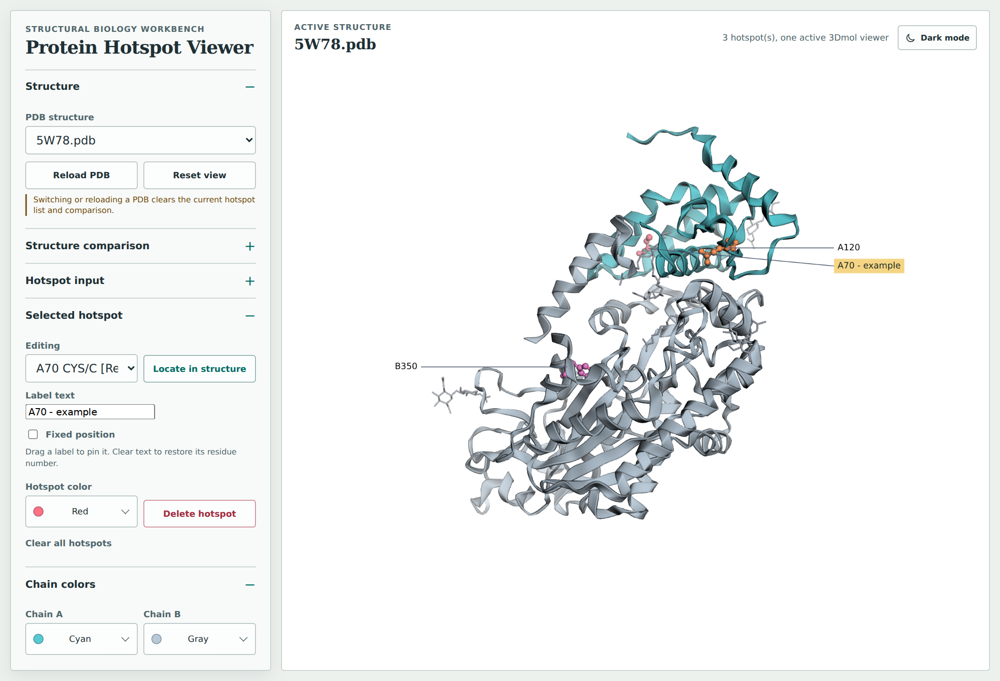
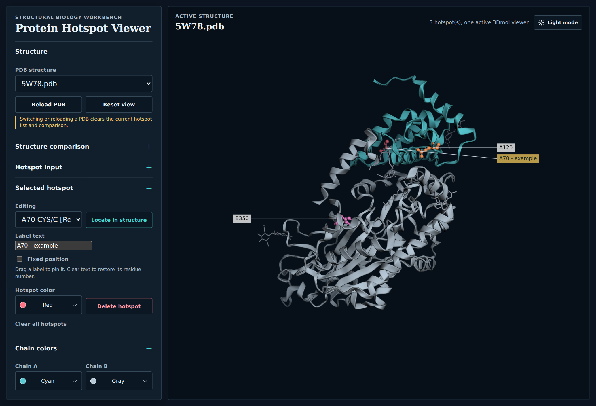

# Protein Hotspot Viewer

Inspect local PDB structures, highlight residues, and compare two proteins in a
browser. Arrange editable hotspot labels, then save the current view as a PNG or
a looping rotation GIF. Runs with a small Python server and 3Dmol.js, with no
additional Python runtime dependencies.



*Light mode — chain colors, highlighted residues, and custom labels with leader lines.*



*Dark mode — the same structure and view. These example residues illustrate the
interface; their selection does not imply a biological function.*

## Features

- **Explore local structures:** switch between PDB files, rotate and zoom, and
  choose colors for chains A and B. Light and dark themes include the 3D canvas.
- **Highlight residues:** enter hotspots such as `A128`, `A:128`, or `A 128`,
  or import a TXT list. Change individual colors, locate residues, or delete them.
- **Arrange labels:** drag a label to pin its position, customize its text, or
  return it to automatic placement. Thin leader lines point to each hotspot.
- **Compare two PDBs:** align one chain from each structure and overlay both
  models, with independent visibility and comparison color. Inspect fitted
  Cα-pair count, RMSD, sequence identity, and chain coverage.
- **Save the view:** capture a full-resolution PNG or export a looping rotation
  GIF with a white or dark background, including visible structures and labels.
- **Keep files local:** PDB data loads on demand without being embedded in the
  generated HTML. Exports are saved inside the project and ignored by Git.

## Quick Start

From the repository directory, with **Python 3.11+** and a WebGL-capable browser:

```bash
python build_viewer.py
```

The server opens the viewer automatically when a desktop browser is available.
Internet access is needed to load 3Dmol.js from jsDelivr.

Or open the local address:

```text
http://127.0.0.1:8766/
```

The root address redirects directly to the viewer, including when opening a
VS Code forwarded port. The `/hotspot_viewer.html` address still works.

The local server stops 15 seconds after the last open viewer page closes. If the
browser cannot send a close signal, the server stops after 60 seconds without a
viewer heartbeat. With `--no-browser`, it waits for the first viewer page to open.

Useful options:

```bash
python build_viewer.py --build-only
python build_viewer.py --no-browser
python build_viewer.py --port 8766
python build_viewer.py --host 127.0.0.1
```

Browser auto-opening runs separately from the HTTP server, so a slow or blocked
browser launcher cannot prevent the page from loading. Terminal browsers such as
`w3m` are skipped because the viewer needs WebGL. If auto-opening fails, open the
printed URL in a desktop browser, or start with `--no-browser` to skip the launcher.

When running through remote VS Code, forward port **8766** in the **Ports** panel
and open the forwarded URL in your local desktop browser. If VS Code assigns a
different local port, use the URL shown in that panel. A stale `BROWSER` environment
variable can prevent auto-opening, but does not prevent the server from responding.

## Project Layout

```text
protein_viewer/
├── build_viewer.py              # Builds manifests/HTML and optionally serves locally
├── hotspot_viewer.html          # Generated viewer kept for immediate use
├── viewer_src/                  # Source HTML template, CSS, and browser JS
├── docs/images/                 # Interface screenshots displayed in this README
├── pdbs/                        # PDB data and generated PDB manifest
├── hotspots/                    # Hotspot TXT files and generated hotspot manifest
├── gifs/                        # GIF exports, created on first save and ignored by Git
├── screenshots/                 # PNG exports, created on first save and ignored by Git
└── tests/                       # Server, alignment, and browser regression checks
```

`hotspot_viewer.html`, `pdbs/manifest.json`, and `hotspots/manifest.json` are
generated outputs. They are intentionally kept in the repository so the viewer is
ready to run after checkout.

## Data Workflow

Add PDB files under `pdbs/`, then rebuild:

```bash
python build_viewer.py --build-only
```

Add hotspot TXT files under `hotspots/`, then rebuild. TXT contents use the same
syntax as manual hotspot input, for example:

```text
A18, A200
```

Use a local HTTP server rather than `file://`, because browser `fetch()` calls for
local PDB and TXT files are not reliable from `file://`.

## Hotspot labels

Labels sit outside the structure where space allows, with thin lines pointing to
their hotspots. They follow rotation and zoom without changing the framing.
Drag a label to pin it at a position in the canvas; the leader line still follows
its hotspot. In **Selected hotspot**, edit **Label text** (single line, up to 80
characters) or uncheck **Fixed position** to return to automatic layout. Blank
text restores the residue number. Long labels are shortened with an ellipsis.
Pinned labels may overlap; automatic labels avoid them. Label settings are included
in GIFs and last until the hotspot is deleted, cleared, or its PDB/page is reloaded.
Off-screen hotspots are not labeled; crowded views prioritize the selected
hotspot and omit labels that cannot fit. Lines adapt to the page or GIF background.

## Compare two structures

Open **Structure comparison**, choose a **Comparison PDB**, and select one
**Reference chain** and one **Comparison chain**. Click **Align and overlay**.
The current PDB stays fixed; the second PDB is rotated and translated as a whole
using the selected chains. Applying an alignment fits both structures into view.
The source PDB files are never modified.

The reference keeps its existing chain colors, hotspots, and draggable labels.
The comparison is cyan by default; change its color or use the independent
visibility checkboxes to inspect either structure. Colors and visibility preserve
the current camera view. Hotspots and sequence editing always belong to the
reference, even if the comparison has identical chain names and residue numbers.
**Remove comparison** restores the reference alone. Changing either alignment
chain invalidates the previous fit. Reloading or switching the reference clears
the comparison; comparison state is not saved across page refreshes.

Correspondence uses a global amino-acid sequence alignment (match +2, mismatch
−1, gap −2), independent of residue numbering. A proper least-squares rigid fit
uses corresponding Cα pairs, including substitutions, without scaling, reflection,
or outlier removal. Only the first PDB model and conventional blank/A alternate
locations are used; missing Cα atoms never use a different atom as a substitute.
At least three non-collinear Cα pairs are required. Very large sequence alignments
(over 50 million traceback cells) are rejected to protect browser memory.

The result reports paired Cα count, fitted **RMSD in Å**, sequence identity among
aligned residue pairs (excluding gaps, with unknown residues not counted as
identical), and Cα-pair coverage of each selected chain. These describe the matched
parts of those chains, not the entire complex. Identity below 30% adds a reminder
that the RMSD may not be meaningful; it does not prevent viewing and is not a
homology test. The bundled 5W78 and 7TQO structures are different proteins and
should not be treated as a validated homologous pair.

GIF export includes both currently visible structures and the reference labels.
Loading or alignment disables export; exporting locks comparison controls. Files
continue to use the reference PDB name. No runtime dependencies are added.

## Canvas screenshots

Click **Canvas screenshot → Save screenshot** to save the current pose as a
lossless PNG in `screenshots/`. The folder is created on first save and ignored
by Git. The page shows a link to the saved file, named after the reference PDB
with a timestamp and unique suffix; repeated captures never overwrite files.

Screenshots use the canvas's actual pixel dimensions (including display pixel
density), its current theme background, visible structures, hotspots, highlights,
and custom labels with leader lines. Sidebars, buttons and the DOM legend are
excluded. No camera, zoom or background settings are changed. After the pixels
are captured you can continue editing while encoding and saving finish; those
edits do not change the captured image.

Screenshot and GIF export are mutually exclusive. Screenshots are unavailable
while a structure loads, alignment or a locate animation runs, or no structure
is visible. Saving requires the project's Python server and has a 64 MiB limit.
Errors restore the button without changing your current view.

## Rotation GIF export

Start the viewer with `python build_viewer.py`, arrange the view and hotspots,
then use **Rotation GIF → Export GIF**. The export captures the structure view without page controls,
including chain colors, hotspots, leader-line labels and selected highlight.
It starts from the current angle, rotates once around the screen's vertical axis,
and loops forever. Zoom and framing stay as they are; anything outside the view
is cropped during rotation.

The default is a **640 px long edge, 4 seconds per turn, 20 fps**. Choose a
480/640/800 px long edge, 2/4/6 seconds, and 10/20 fps. The canvas aspect ratio is
preserved. GIF uses a limited color palette, so some color quantization is normal.

The live viewer follows the page theme: pure white in light mode and dark
(`#071019`) in dark mode. **GIF background** independently selects **Pure white**
or **Dark**, defaulting to pure white each time the page opens. Changing this
selection does not change the live view; it is applied only during export and
is not saved across page reloads.
The white canvas is exactly `#FFFFFF`; GIF palette quantization can introduce a
slight color difference in the saved image (for example, RGB 254 instead of 255).

Structure controls are temporarily locked while exporting. Progress shows capture,
encoding and saving; **Cancel** is available until saving starts. The original
view, theme background and controls are restored on success, cancellation or failure.

The project server creates `gifs/` on the first successful export and saves
`PDBname-UTCtimestamp-uniqueID.gif` without overwriting existing files. A link to
the saved file appears below the controls. `gifs/` is excluded from Git.
Saving requires this project's server, not a generic static server or `file://`.
Uploads are limited to 64 MiB; if exporting fails, try fewer frames or a smaller
size and check that the server can write to the project directory.

GIF encoding uses the locally bundled **gif.js 0.2.0** and Web Workers under
`viewer_src/vendor/gif.js-0.2.0/` (MIT license included). It adds no Python runtime
dependencies. 3Dmol.js still requires network access as before.

## Development

Validate the builder and generated output:

```bash
python -m py_compile build_viewer.py
python build_viewer.py --build-only
python -m unittest discover tests
```

Optional browser integration checks (development only, requires Playwright,
its Chromium browser, and Pillow):

```bash
python tests/verify_gif_browser.py
python tests/verify_comparison_browser.py
python tests/verify_screenshot_browser.py
```

This builds the page, saves white- and dark-background sample GIFs in `gifs/`,
checks their decoded frames and timing, and exercises theme switching,
cancellation, worker failures, heartbeat and save failures.

The browser app source lives in `viewer_src/`. After editing `viewer_src/` or
`build_viewer.py`, rerun:

```bash
python build_viewer.py --build-only
```

## Requirements

- Python 3.11+ recommended.
- Browser with WebGL support.
- Network access to jsDelivr for `3Dmol.js`.

## Notes

- Full PDB contents must not be embedded in `hotspot_viewer.html`.
- PDB and hotspot filenames are preserved because they often carry biological
  identifiers.
- Browser warnings about WebGL performance in headless tests are acceptable;
  `3Dmol.js failed to load` is not.

Alignment math can also be checked without a browser or packages:

```bash
node tests/test_alignment.cjs
```

The comparison browser check uses a synthetic rigid transform with a displaced
second chain, checks model isolation and asynchronous selection changes, and
saves a two-structure sample GIF in `gifs/`.
